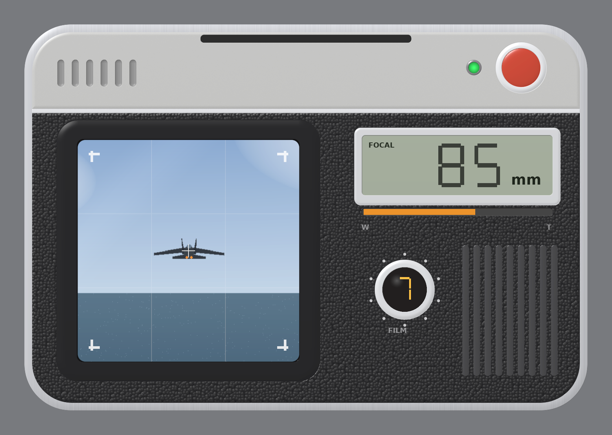
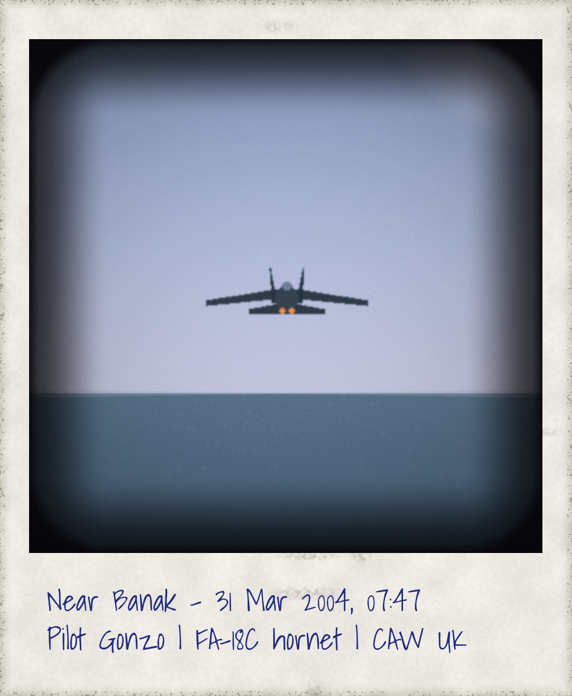
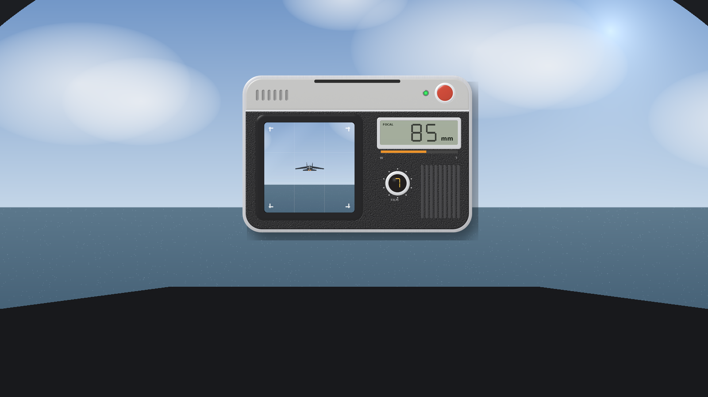

# DCS Instant Cam

A handheld instant camera for **every aircraft in DCS World** – in VR and on a flat screen.
Raise the camera, aim it with the mouse, zoom, take the shot and watch the print slide out and develop,
complete with handwritten notes on where and when it was taken.


This is an independent mod and contains no Heatblur code or assets.

| The camera | A saved print | Flat screen |
|---|---|---|
|  |  |  |

*Preview images use a test scene; in DCS the camera shows your real view.*

## Features
- Works in any aircraft, single player and multiplayer, client side only (nothing needed on the server)
- VR (OpenXR) and flat screen (DirectX 11)
- Retro camera with live screen, zoom 24–200 mm, focal-length LCD and a 10-shot film counter
- Instant-film look on a worn paper card, with handwritten captions:
  `Near Banak – 31 Mar 2004, 07:47` / `Pilot Gonzo | FA-18C hornet | your note`
- Photos saved as PNG – ready for an OpenKneeboard tab

## Install
1. Download `DCS_InstantCam_Setup_v1.3.exe` from the [Releases](../../releases) page.
2. Run it. Windows may say "Windows protected your PC" because the installer isn't code-signed: click **More info → Run anyway**.
3. Start DCS and press **Mouse 4** in the cockpit.

To uninstall use *Settings → Apps → DCS Instant Cam*. Your photos are kept.

## Controls
| Input | Action |
|---|---|
| Mouse 4 (side button) | Raise / lower the camera |
| Move mouse | Aim |
| Scroll wheel | Zoom |
| Left click | Take the photo |
| Middle click | Recenter |
| Right click | Lower the camera |

While the camera is up, DCS doesn't receive the mouse. Keyboard/HOTAS bindings and all other options are in
`Saved Games\InstantCam\InstantCam.ini`.

## Where things go
- Photos: `Saved Games\InstantCam\Photos\` (newest also as `Saved Games\InstantCam\Latest.png`)
- Settings and log: `Saved Games\InstantCam\`
- The installer adds one line to `Saved Games\DCS\Scripts\Export.lua` (backup kept) and
  `Saved Games\DCS\Scripts\Hooks\InstantCamHook.lua`. Nothing in the DCS install folder is changed.

## Requirements and limits
- DCS on DirectX 11 (Vulkan not supported yet)
- VR through native OpenXR; Quad Views / foveated rendering supported
- Flat-screen photos are taken from the screen, so on-screen labels or messages can appear in them
- If a server disables player export, captions show only the date and time

## Building from source
On Linux or WSL (Ubuntu):
```
sudo apt-get install -y g++-mingw-w64-x86-64 nsis git python3
./build.sh
```
The installer is written to `dist/`. GitHub Actions builds it on every push and attaches it to each published release.

## How it works
- **VR:** an OpenXR API layer draws the camera and print as quad layers and takes the photo from the eye images DCS submits.
- **Flat screen:** a DCS GUI hook loads the same DLL, which draws on the swap chain before it is presented.
- **Captions:** `InstantCamExport.lua` sends your position, pilot name and mission time. The hook writes the mission date and the map's town list.

## Credits
- Handwriting font: *Shadows Into Light* by Kimberly Geswein (SIL Open Font License)
- Inspiration: Heatblur Simulations' F-14 instant camera

## License
MIT – see [LICENSE](LICENSE).
